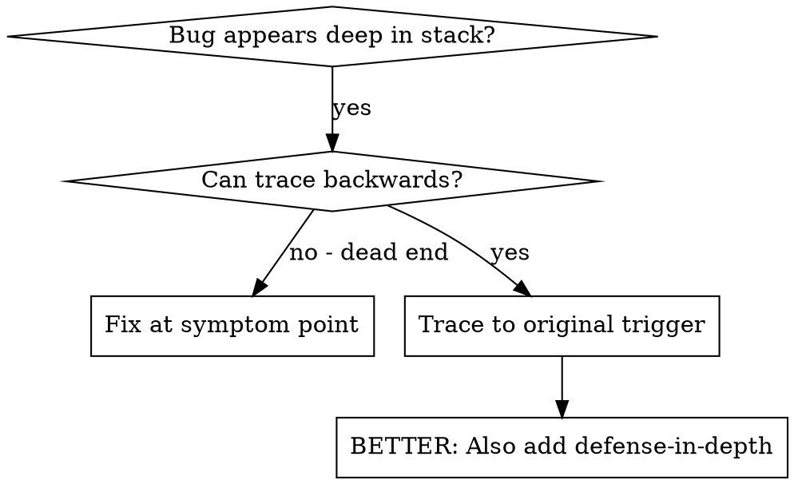
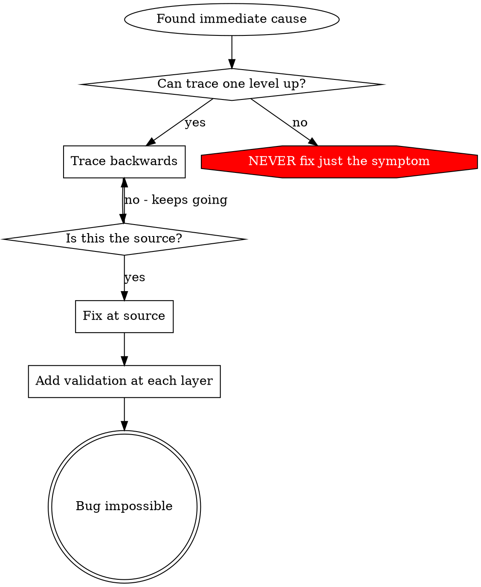

> Adapted from obra/superpowers (MIT); Go examples. See `../LICENSE-THIRD-PARTY.md`.

# Root Cause Tracing

## Overview

Bugs often manifest deep in the call stack (git init in wrong directory, file created in wrong location, database opened with wrong path). Your instinct is to fix where the error appears, but that's treating a symptom.

**Core principle:** Trace backward through the call chain until you find the original trigger, then fix at the source.

## When to Use



**Use when:**
- Error happens deep in execution (not at entry point)
- Stack trace shows long call chain
- Unclear where invalid data originated
- Need to find which test/code triggers the problem

## The Tracing Process

### 1. Observe the Symptom
```
insert_session: ERROR: null value in column "job_id" (SQLSTATE 23502)
```

### 2. Find Immediate Cause
**What code directly causes this?**
```go
_, err := q.Exec(ctx, insertSession, s.JobID, s.CandidateID)
```

### 3. Ask: What Called This?
```go
store.InsertSession(ctx, s)
  → called by service.StartInterview(ctx, req)
  → called by handler.postSession (chi)
  → called by the test TestPostSession
```

### 4. Keep Tracing Up
**What value was passed?**
- `s.JobID = uuid.Nil` (zero value!)
- The zero UUID is sent as NULL by the mapper
- So the bug is upstream of the DB

### 5. Find Original Trigger
**Where did empty string come from?**
```go
req := sessionReq{CandidateID: cid} // JobID never decoded: JSON tag was "jobId" vs "job_id"
```

## Adding Stack Traces

When you can't trace manually, add instrumentation:

```go
func (s *Store) InsertSession(ctx context.Context, in Session) error {
	fmt.Fprintf(os.Stderr, "DEBUG insert: %+v
%s
", in, debug.Stack())
	// ...
}
```

**Critical:** write to stderr or `t.Logf` in tests, and run with `-v`

**Run and capture:**
```bash
go test ./... -run TestPostSession -v -count=1 2>&1 | grep 'DEBUG insert'
```

**Analyze stack traces:**
- Look for test file names
- Find the line number triggering the call
- Identify the pattern (same test? same parameter?)

## Finding Which Test Causes Pollution

If something appears during tests but you don't know which test:

Run `go test -count=1 -shuffle=on -v ./pkg/...` to expose order dependence, then narrow with `-run 'TestA|TestB'` (halve the list each time). `go test -race` for shared-state pollution.

## Worked Example: NULL job_id

**Symptom:** `insert_session` fails with `null value in column "job_id"`

**Trace chain:**
1. pgx `Exec` sends NULL ← `s.JobID` is `uuid.Nil`
2. `service.StartInterview` copied it from the request struct
3. `handler.postSession` decoded JSON into `sessionReq`
4. The JSON tag was `jobId`; the contract (`docs/API.md`) says `job_id`

**Root cause:** contract drift in a struct tag

**Fix:** correct the tag and add a table test case for the missing field

**Also added defense-in-depth:**
- Layer 1: handler rejects a zero `job_id` with 400
- Layer 2: service validates required IDs
- Layer 3: the column stays `NOT NULL` (DB is the last guard)

## Key Principle



**NEVER fix just where the error appears.** Trace back to find the original trigger.

## Stack Trace Tips

**In tests:** Use `console.error()` not logger - logger may be suppressed
**Before operation:** Log before the dangerous operation, not after it fails
**Include context:** Directory, cwd, environment variables, timestamps
**Capture stack:** `new Error().stack` shows complete call chain

## Real-World Impact

From debugging session (2025-10-03):
- Found root cause through 5-level trace
- Fixed at source (getter validation)
- Added 4 layers of defense
- 1847 tests passed, zero pollution
