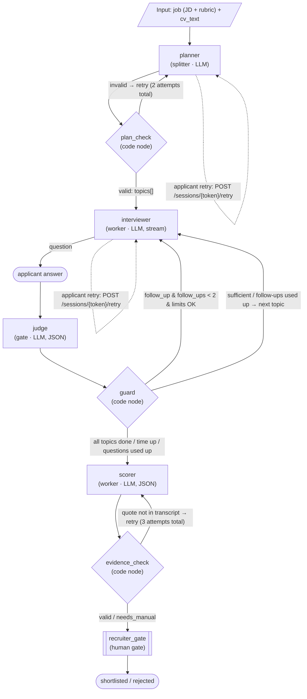

# Talent Scout — Server

Go backend for Talent Scout, a recruiter-side AI screening tool. An applicant
applies with a name, email and CV (PDF), receives a single-use session link
(valid for 7 days), and has a ~15-minute chat with a multi-agent graph. The
graph asks questions topic by topic, judges each answer, and scores the
transcript against the job rubric with verbatim evidence. The recruiter decides.

This repository is the Go server. The SvelteKit client (a server-side BFF) lives
in a separate repository and talks to this API server-to-server; only the two
SSE routes are called from the browser.

- Contract: [`docs/API.md`](docs/API.md), [`docs/EVENTS.md`](docs/EVENTS.md),
  [`api/openapi.yaml`](api/openapi.yaml)
- Design: [`docs/ARCHITECTURE.md`](docs/ARCHITECTURE.md), [`docs/PRD.md`](docs/PRD.md)
- Stack and env reference: [`docs/TECH-STACK.md`](docs/TECH-STACK.md)

## Agent graph



Every node attempt emits `node.started` and then a terminal event; every
transition emits `edge.traversed`. Events except `message.delta` are persisted
to `node_events` before they are published, so both the session stream and the
run stream can replay from the database. Code nodes (`plan_check`, `guard`,
`evidence_check`) never call an LLM.

Limits: 3–5 topics, at most 2 follow-ups per topic, 15 AI questions and 15
minutes per session, planner 2 attempts total, evidence-check retries 3 attempts
total. A permanent graph failure ends the session as `failed`; the recruiter can
issue a new invite.

## Run locally

Requirements: Go 1.23+ and a Postgres database (the Supabase project is fine —
see `docs/TECH-STACK.md` §3 and §7). `go test ./...` needs no database.

```sh
cp .env.example .env        # fill in the values; .env is gitignored
go run ./cmd/migrate up     # create the schema (goose, embedded migrations)
go run ./cmd/seed           # idempotently create the demo job from config/seed-job.yaml
go run ./cmd/server         # listens on :8080
```

Run these from the repository root: `MODELS_CONFIG_PATH` defaults to
`./config/models.yaml`. Migrations are not run automatically at boot.

Check it:

```sh
curl 'http://localhost:8080/api/v1/health?deep=1'
# {"status":"ok","version":"0.1.0","llm_mode":"openrouter","email_mode":"log","db":"ok"}
```

Green checks (no network, no database: in-memory store, fake storage,
`LLM_MODE=fake`, `EMAIL_MODE=log`):

```sh
gofmt -l .                  # must print nothing
go vet ./...
go test ./...
```

Store integration tests run only when `TEST_DATABASE_URL` is set (a `test`
schema in the same Supabase project); otherwise they are skipped. There is also
an opt-in live OpenRouter E2E behind the `live` build tag; it is not part of the
green checks.

## API

Base path `/api/v1`. Public: `GET /health`, `GET /jobs/{jobId}/public`, the
apply endpoint and the applicant session routes (path token). Recruiter routes
use a 12-hour bearer token from `POST /auth/login` in the `Authorization`
header; the run SSE route uses a 60-second `?sse_token=`. See `docs/API.md` for
the full contract and error format.

Useful entries:

- `GET /api/v1/health?deep=1` — readiness, checks the database
- `POST /api/v1/auth/login` — recruiter bearer token
- `POST /api/v1/jobs/{jobId}/applications` — multipart apply (PDF ≤ 2 MB)
- `POST /api/v1/sessions/{token}/start`, `POST .../messages`, `.../retry`
- `GET /api/v1/sessions/{token}/events` — applicant SSE
- `GET /api/v1/graph-runs/{runId}/events?sse_token=` — recruiter run SSE

## Environment variables

All values belong in `.env` locally (gitignored) and in Railway Variables in
production. `.env.example` lists every variable without secrets. Defaults below
are the code defaults in `internal/config/config.go`.

| Name | Default | Notes |
|---|---|---|
| `PORT` | `8080` | Set automatically by Railway. |
| `APP_ENV` | `development` | Use `production` on Railway. |
| `DATABASE_URL` | — | Required for a database-backed server. Supabase **session pooler** URL (port 5432, `sslmode=require`); not the transaction pooler. Secret. |
| `SUPABASE_URL` | — | `https://<project_ref>.supabase.co` (Storage API). |
| `SUPABASE_SERVICE_ROLE_KEY` | — | Server only; never expose to the client. Secret. |
| `SUPABASE_STORAGE_BUCKET` | `cvs` | Private bucket for CV PDFs. |
| `PUBLIC_APP_URL` | `https://talentscout.vercel.app` | Base for `/apply/{jobId}` and `/s/{token}` links. |
| `FRONTEND_ORIGIN` | — | Comma-separated CORS origins for the two SSE `GET` routes only, e.g. the Vercel URL plus `http://localhost:5173`. No wildcard. |
| `BFF_SHARED_SECRET` | — | Must equal the client's value. Only when `X-BFF-Secret` matches is `X-Forwarded-For` trusted for the apply/client-IP rate limit. Secret. |
| `RECRUITER_PASSWORD` | — | The single MVP recruiter password. Secret. |
| `AUTH_TOKEN_SECRET` | — | HMAC key for bearer/SSE tokens, at least 32 bytes. Secret. |
| `LLM_MODE` | `openrouter` | `openrouter` or `fake`. Use `fake` for tests/e2e. |
| `LLM_BASE_URL` | `https://openrouter.ai/api/v1` | OpenAI-compatible base URL. |
| `OPENROUTER_API_KEY` | — | The app key (not the coding-agent key). Secret. |
| `MODELS_CONFIG_PATH` | `./config/models.yaml` | Per-node models, temperatures and token caps. |
| `EMAIL_MODE` | `log` | `log` prints the invite link to the log and returns it from `resend-invite`; `gmail` sends through the Gmail API. |
| `GMAIL_CLIENT_ID` | — | Only with `EMAIL_MODE=gmail`. |
| `GMAIL_CLIENT_SECRET` | — | Only with `EMAIL_MODE=gmail`. Secret. |
| `GMAIL_REFRESH_TOKEN` | — | Only with `EMAIL_MODE=gmail`; scope `gmail.send`; OAuth consent screen must be In production. Secret. |
| `EMAIL_FROM` | `Talent Scout <you@gmail.com>` | Must be the Gmail account or a verified send-as alias. |
| `SESSION_TTL_HOURS` | `168` | Session link lifetime (7 days). |
| `SESSION_MAX_MINUTES` | `15` | Maximum interview duration. |
| `SESSION_MAX_QUESTIONS` | `15` | Maximum AI questions. |
| `LOGIN_MAX_ATTEMPTS` | `5` | Failed `/auth/login` attempts allowed per client IP per window. Must be > 0. |
| `LOGIN_WINDOW_MINUTES` | `15` | Login rate-limit window. Must be > 0. |
| `MESSAGE_MAX_PER_WINDOW` | `20` | `POST /sessions/{token}/messages` allowed per session per window. Must be > 0. |
| `MESSAGE_WINDOW_MINUTES` | `10` | Message rate-limit window. Must be > 0. |
| `TEST_DATABASE_URL` | — | Optional; store integration tests only. Session pooler URL with `search_path=test`. |

The four rate-limit counters live in memory, so the server must run as a single
replica (see the deploy section). A restart resets them.

## Models per node

From `config/models.yaml`; prices are OpenRouter USD per 1M tokens (checked
2026-11-05, recheck before deploying). The LLM client retries one HTTP failure
on the same model and does not fall back to another model.

| Node | Model | Temperature | Max output tokens | Price in / out |
|---|---|---|---|---|
| `planner` | `deepseek/deepseek-v4.1-flash` | 0.2 | 3000 | $0.045 / $0.50 |
| `interviewer` | `z-ai/glm-5.3-flash` | 0.6 | 4000 (streamed, reasoning effort low) | $0.15 / $0.50 |
| `judge` | `deepseek/deepseek-v4.1-flash` | 0.0 | 1200 | $0.045 / $0.50 |
| `scorer` | `deepseek/deepseek-v4.1-flash` | 0.0 | 4000 | $0.045 / $0.50 |

## Cost

| Item | Cost |
|---|---|
| Railway Hobby (Go server, no volume) | $5/month, includes $5 usage |
| Supabase Free (Postgres 500 MB, Storage 1 GB) | $0 |
| Vercel Hobby (client) | $0 |
| LLM per session | ~$0.003–0.008 estimated; observed live sessions $0.0068–$0.0124 |
| 100 demo sessions | < $1 |
| OpenRouter key for the coding agent (separate) | capped by credit limit |

A session is roughly 25–35 LLM calls and 27k–37k input tokens. The Supabase
free project pauses after 7 days without activity; open the dashboard (or call
`GET /api/v1/health?deep=1`) before a demo.

## Deploy (Railway + Supabase)

### 1. Supabase

1. Create the project and a **private** Storage bucket named `cvs`.
2. Copy the **session pooler** connection string (Connect → Session pooler,
   port 5432) into `DATABASE_URL`. It is the only database URL the server and
   `cmd/migrate` use.
3. From a trusted machine with the production `DATABASE_URL` in the
   environment, run the migration and the seed. These are the only production
   writes an operator runs:

   ```sh
   go run ./cmd/migrate up
   go run ./cmd/seed
   ```

4. Check Supabase **Advisors → Security**. It must be clean: every table
   (including `goose_db_version`) has RLS enabled with no policies, and
   `anon`/`authenticated` have no privileges. Migrations enforce this; never add
   a public policy or the service-role key to the client.

### 2. Railway

1. Create a project and a service from the GitHub repository. Railway uses the
   root `Dockerfile` (multi-stage build, distroless static binary).
2. Add the variables from the table above, at minimum: `APP_ENV=production`,
   `DATABASE_URL`, `SUPABASE_URL`, `SUPABASE_SERVICE_ROLE_KEY`,
   `SUPABASE_STORAGE_BUCKET=cvs`, `PUBLIC_APP_URL` (the Vercel URL),
   `FRONTEND_ORIGIN` (the Vercel URL, comma-separated with any local origin),
   `BFF_SHARED_SECRET` (same value as on Vercel), `RECRUITER_PASSWORD`,
   `AUTH_TOKEN_SECRET`, `LLM_MODE=openrouter`, `OPENROUTER_API_KEY`,
   `MODELS_CONFIG_PATH=./config/models.yaml`, and `EMAIL_MODE=log` (or `gmail`
   plus the `GMAIL_*` values). Secret values are entered in the Railway
   dashboard, never committed.
3. Expose a public domain (Railway → Settings → Networking → Generate Domain).
4. Set the service to **exactly 1 replica** and disable deploy overlap:
   Railway → service → Settings → Deployment Teardown, or set the service
   variable `RAILWAY_DEPLOYMENT_OVERLAP_SECONDS=0` (the docs' default is 0; set
   it explicitly). Optionally give the old container a drain window with
   `RAILWAY_DEPLOYMENT_DRAINING_SECONDS`.

### Deploy caveats (MVP, single instance)

On boot the server fails every graph run still marked `running` (reason
`server_restart`); it does not know which process owns a run. If Railway ran
the old and new containers side by side, the new container would fail runs the
old one is still serving. That is why the service must run **one replica with
overlap off**. Rate-limit counters are also in memory, which needs the same
single-instance setup.

A deploy therefore ends any in-flight interview: the run and session become
`failed` and the application moves to `failed`. The recruiter recovers the
applicant with **"Get invite link"** (`resend-invite`). Deploy when no session
is active. Per-instance run ownership (instance id plus heartbeat) is post-MVP.

### 3. Verify production

```sh
curl 'https://<railway-domain>/api/v1/health?deep=1'
# {"status":"ok","version":"0.1.0","llm_mode":"openrouter","email_mode":"log","db":"ok"}
```

Then run one real session end to end from the client: apply → copy the invite
link from the dashboard (or the log) → start → answer → scores with evidence →
recruiter decision. `deep=1` returning 503 with `db_unavailable` usually means
the Supabase project is paused or `DATABASE_URL` is wrong.

Out of scope: custom domain, SMTP (Railway blocks outbound SMTP; `EMAIL_MODE=log`
is the MVP default and Gmail API is optional).
