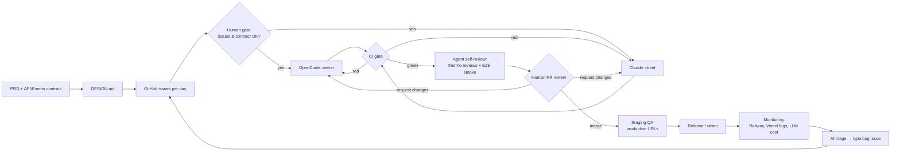
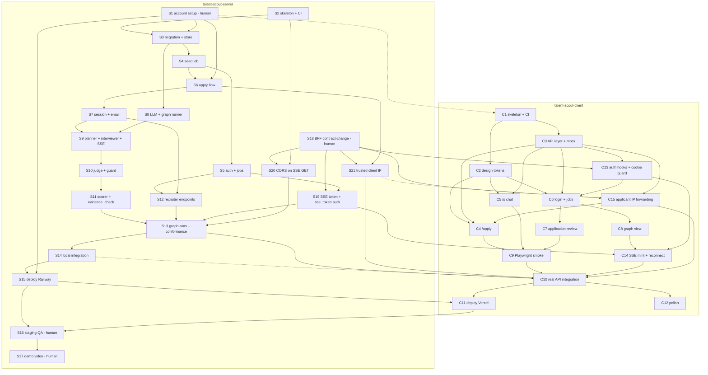
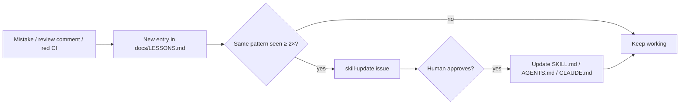
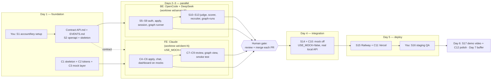

# WORKFLOW — Talent Scout (agentic workflow)

This document explains how the Talent Scout project is built by two coding agents and one human over 7 days: who does what, labels, issue order, the work loop, the learning loop, CI, skills, and the GitHub issue list.

- Server repo: https://github.com/aangwijaya/talent-scout-server (Go, built by **OpenCode + DeepSeek**)
- Client repo: https://github.com/aangwijaya/talent-scout-client (SvelteKit, built by **Claude**)
- This master folder (`talent-scout/`) is not a git repo. That's why the core workflow rules are also copied in full into `talent-scout-server/AGENTS.md` and `talent-scout-client/CLAUDE.md` (the "Agentic Workflow" section), so the agents don't depend on this file.
- Daily plan: `PLAN.md` (master) and `PLAN.md` in each repo.
- Parallel BE/FE flow, agent count, and `git worktree` rules: §9–§11.

---

## 1. Roles & overall flow

| Role | Who | Responsibilities |
|---|---|---|
| Product owner / reviewer | Aang (human, `agent:human`) | Account & API key setup, approving `contract-change`, PR review & merge, staging QA, demo |
| Server agent | OpenCode + DeepSeek (`agent:opencode`) | All server repo issues labeled `agent:opencode` |
| Client agent | Claude (`agent:claude`) | All client repo issues labeled `agent:claude` |
| Contract source of truth | Server repo | `docs/API.md`, `docs/EVENTS.md`, `docs/PRD.md` (the client keeps byte-identical copies) |
| Server-side (BFF) proposal | Client repo | `docs/SERVER-SIDE.md` — SvelteKit server-side auth/API/SSE/IP flow; approved 2026-11-05 (server#18) |

The company flow being imitated (at small scale):



---

## 2. Labels

The same labels are created in **both** repos (19 custom labels; GitHub's default labels are not used by the workflow).

| Label | Color | Meaning |
|---|---|---|
| `agent:opencode` | `#5319e7` | Done by OpenCode (server) |
| `agent:claude` | `#d4a373` | Done by Claude (client) |
| `agent:human` | `#0e8a16` | Done by a human (account/key setup, review, demo) |
| `status:todo` | `#ededed` | Ready to work on once all blockers are closed |
| `status:in-progress` | `#fbca04` | Being worked on |
| `status:review` | `#0075ca` | PR open, waiting for human review |
| `status:blocked` | `#b60205` | Failed 3× or needs a human decision; see comments |
| `type:feat` | `#a2eeef` | New feature |
| `type:bug` | `#d73a4a` | Bug fix |
| `type:chore` | `#cfd3d7` | Setup, CI, deploy, documentation, tests |
| `day:1` … `day:7` | `#bfdadc` | Day N of the 7-day plan |
| `contract-change` | `#d93f0b` | Changes `docs/API.md`, `EVENTS.md`, or `PRD.md`; needs human approval |
| `skill-update` | `#c5def5` | Agent skill/rule update from `docs/LESSONS.md` |

Note: the client repo has a leftover `type:test` label (no description) that was accidentally auto-created while creating issue #9; issue #9 has been moved to `type:chore`. That label is not used by the workflow and can be deleted manually.

Every issue has exactly one `agent:*`, one `type:*`, one `day:N`, and one `status:*`.

---

## 3. Issue graph (Blocked by)

An arrow `A --> B` means **B is blocked by A** (A must be closed first). `S#` = server, `C#` = client. Dashed lines = related, not a blocker.



Critical path: S2 → S3 → S4 → S6 → S7 → S9 → S10 → S11 → S13 → C10 → C11 → S16 → S17 (S18 → S19/S20 must also land before S13, and C13/C14/C15 before C10). The client runs days 1–3 in parallel on mocks and doesn't wait for the server.

---

## 4. Autonomous work loop (per agent)

The same for both agents; the only differences are the repo, the `agent:*` label, and the green-check commands. Command details are in each repo's `issue-workflow` skill.

1. **Pick** an `agent:<me>` + `status:todo` issue with the lowest `day:N` whose "Blocked by" issues are all **closed** (cross-repo blockers are checked with `gh issue view N -R <owner/repo>`). None → stop & report.
2. **Start**: label → `status:in-progress`; work in your own **worktree** (§11) on a branch from `origin/main`: `feat/<n>-<slug>` / `fix/<n>-<slug>` / `chore/<n>-<slug>`. Check that `git rev-parse --git-dir` contains `/worktrees/`; if not → stop.
3. **Read** `docs/LESSONS.md` + every document under "Docs to read".
4. **Do** only that issue's acceptance criteria (see "Out of scope").
5. **Self-check** (skills in §7): `verify-this` (only when claiming a fix) → `deslop` → local **green checks** (server: `gofmt`, `go build`, `go vet`, `go test`; client: `pnpm check`, `pnpm lint`, `pnpm build`, + `pnpm test:e2e` once it exists) → `impeccable audit` + `polish` (client UI PRs only) → `thermo-nuclear-review` + `thermo-nuclear-code-quality-review` (report-only, once per PR, fix only blockers). Failing → fix, **at most 3 attempts**; after that `status:blocked` + a comment (what was tried, the last error, the suspected cause), move to another issue.
6. **Hand off**: push, `gh pr create` using `.github/pull_request_template.md` with `Closes #<n>` and the unfixed review findings; label → `status:review`.
7. **CI**: `loop-on-ci` / `fix-ci` until green (once CI exists: server #2, client #1).
8. **Record** lessons in `docs/LESSONS.md` (in the same PR) when there was a useful mistake/finding.
9. A human reviews → `get-pr-comments` → fix → back to 7. The human merges → the issue closes automatically → back to step 1.

Hard limits: agents never merge, force-push, push to `main`, close issues themselves, or change contract documents without an approved `contract-change` issue. Agents may only create `type:bug` or `contract-change` issues (no new features). Agent sessions are restarted every 2–4 issues to keep the context clean. Secrets live only in `.env` / env vars, never committed.

---

## 5. Learning loop



- `docs/LESSONS.md` exists in both repos, with an entry template (date, issue, symptom, root cause, new rule).
- At the start of every issue the agent must read LESSONS (step 3 above).
- Recurring lessons are promoted to permanent rules through an issue labeled `skill-update` (needs human approval).
- General human review comments ("don't use raw hex", "always check RLS") are also recorded in LESSONS.

---

## 6. CI plan & gates

The CI workflows don't exist in the repos yet (the repos are still empty, CI would fail). Creating them is part of the issues: **server #2** and **client #1** (the e2e step is added in **client #9**).

| Repo | Trigger | Steps |
|---|---|---|
| Server (`.github/workflows/ci.yml`) | `pull_request`, `push` to `main` | `test -z "$(gofmt -l .)"` · `go vet ./...` · `go test ./...` (with `LLM_MODE=fake`, `EMAIL_MODE=log`, in-memory store; no secrets) |
| Client (`.github/workflows/ci.yml`) | `pull_request`, `push` to `main` | `pnpm install --frozen-lockfile` · `pnpm check` · `pnpm lint` · `pnpm build` · `pnpm test:e2e` (mock, from #9) |
| Contract sync (client) | `pull_request` | Compare the md5 of `docs/API.md`, `docs/EVENTS.md`, `docs/PRD.md` with the copies in the server repo (`main`); different → fail, unless the PR is labeled `contract-change` and approved |

Other gates:
- **Branch protection on `main`** in both repos (enabled by a human in server #1): PR required, green CI required, no direct pushes.
- **Human PR review**: the only path to `main`.
- **Staging QA** (server #16): test the happy path on production URLs; bugs → a `type:bug` issue in the right repo.

---

## 7. Agent skills

Findings from the OpenCode docs (https://opencode.ai/docs/skills/):
- OpenCode project skills go in `.opencode/skills/<name>/SKILL.md`. OpenCode also reads `.claude/skills/<name>/SKILL.md` and `.agents/skills/<name>/SKILL.md`; global skills in `~/.config/opencode/skills/`.
- Required frontmatter: `name` (same as the folder name) and `description`.

Decision: server skills in `.opencode/skills/` (OpenCode), client skills in `.claude/skills/` (Claude). Server backend skills come from supabase/agent-skills (MIT), cxuu/golang-skills (Apache-2.0) and obra/superpowers (MIT), trimmed; notices in the server `LICENSE-THIRD-PARTY.md`.

| Repo | Skill | When used |
|---|---|---|
| Server | `issue-workflow` | Every time an issue is started/finished |
| Server | `add-endpoint-from-contract` | Adding an endpoint per `docs/API.md` |
| Server | `migration-with-rls` | Creating a goose migration with RLS on and no policies |
| Server | `supabase-postgres-best-practices` | Query/index/connection-pool review or writing a new migration (opens 1–2 of 12 rule files) |
| Server | `go-error-handling` | Designing or reviewing error flow (`%w`, `errors.Is/As`, wrap vs log) |
| Server | `go-context` | Adding timeouts/cancellation (LLM calls, SSE, DB) or passing context through layers |
| Server | `go-concurrency` | Goroutines, channels, mutexes: runner, event bus, SSE fan-out, sweeper, data races |
| Server | `go-testing` | Writing or reviewing Go tests (table tests, httptest, fakes; stdlib first) |
| Server | `systematic-debugging` | Only after the first failed fix attempt or an unexplained failure; stays within the 3-attempt limit |
| Client | `issue-workflow` | Every time an issue is started/finished |
| Client | `new-page-with-mock` | Building a new page that runs on mocks first |
| Client | `use-design-tokens` | Styling with the `@theme` tokens from `DESIGN.md` |

### Review & CI skills (both repos)

Adapted from [cursor/plugins](https://github.com/cursor/plugins) (MIT; notice in each skills folder's `LICENSE-THIRD-PARTY.md`). Same seven skills in server `.opencode/skills/` and client `.claude/skills/`, with stack-specific checklists (Go/chi/pgx/goose + RLS on the server, SvelteKit/TS + XSS/`PUBLIC_*` on the client).

| Skill | When | Mode |
|---|---|---|
| `verify-this` | After implementing, only when claiming a fix | Baseline vs treatment → VERIFIED / NOT VERIFIED / INCONCLUSIVE in the PR body |
| `deslop` | Before the green checks | Edits the branch diff only, no behavior change |
| `thermo-nuclear-review` | After green checks, before `gh pr create` | Report-only, once per PR: bugs, security (auth, RLS, secrets, tokens, prompt injection / XSS), contract drift |
| `thermo-nuclear-code-quality-review` | Same step | Report-only, once per PR: structure, 1k-line rule, spaghetti, layers |
| `loop-on-ci` + `fix-ci` | After the PR is open, until green | Active once CI exists (server #2, client #1) |
| `get-pr-comments` | After human review | Ordered fix list from review comments |
| `impeccable` (client only) | After green checks, before the thermo reviews, UI PRs only | `audit` report-only + `polish` on the PR's own page; `harden`/`clarify` allowed, `critique` once per major screen. `DESIGN.md` wins. From pbakaus/impeccable v4.8.0 (Apache-2.0), no hook, telemetry off. Banned commands listed in client `CLAUDE.md` |

Order: implement → `verify-this` (if claiming a fix) → `deslop` → green checks → `impeccable audit` + `polish` (client UI PRs only) → `thermo-nuclear-review` + `thermo-nuclear-code-quality-review` (fix only blockers) → open PR → `loop-on-ci`/`fix-ci` → human review → `get-pr-comments` → fix → the human merges. Max 3 fix attempts, then `status:blocked`; agents never merge or force-push. Recurring findings → `docs/LESSONS.md`.

Cost: the two thermo reviews send the full diff plus every changed file, so they run **once per PR** (no review→edit loop). OpenCode ignores `disable-model-invocation`, so each review skill also says in its body: only run when explicitly asked or when `issue-workflow` says so.

---

## 8. Issue list

All issues are created with the `status:todo` label. Each issue body contains Goal, Acceptance criteria (checkboxes), Docs to read, Dependencies, Out of scope.

### Server — `aangwijaya/talent-scout-server` (21 issues: 17 OpenCode, 4 human)

| # | Title | Agent | Day | Blocked by |
|---|---|---|---|---|
| [1](https://github.com/aangwijaya/talent-scout-server/issues/1) | Setup accounts, API keys and local env (human) | human | 1 | — |
| [2](https://github.com/aangwijaya/talent-scout-server/issues/2) | Contract + Go skeleton: openapi.yaml, health endpoint, error writer, CI | opencode | 1 | — |
| [3](https://github.com/aangwijaya/talent-scout-server/issues/3) | DB migration 00001 with RLS + cmd/migrate + store layer (pgx + in-memory) | opencode | 1 | #2, #1 |
| [4](https://github.com/aangwijaya/talent-scout-server/issues/4) | Job seed: cmd/seed + config/seed-job.yaml with rubric validation | opencode | 1 | #3 |
| [5](https://github.com/aangwijaya/talent-scout-server/issues/5) | Recruiter auth (POST /auth/login, HMAC token) + GET jobs endpoints | opencode | 2 | #4 |
| [6](https://github.com/aangwijaya/talent-scout-server/issues/6) | Apply flow: POST /jobs/{jobId}/applications + CV storage + rate limit | opencode | 2 | #4, #1 |
| [7](https://github.com/aangwijaya/talent-scout-server/issues/7) | Session token + email sender (log/gmail) + GET/start session + expiry sweeper | opencode | 2 | #6 |
| [8](https://github.com/aangwijaya/talent-scout-server/issues/8) | LLM client (OpenRouter + fake) + models.yaml + graph runner + event bus | opencode | 2 | #3 |
| [9](https://github.com/aangwijaya/talent-scout-server/issues/9) | Planner + plan_check + streaming interviewer + messages endpoints + session SSE | opencode | 2 | #7, #8 |
| [10](https://github.com/aangwijaya/talent-scout-server/issues/10) | Judge (JSON verdict) + deterministic guard (follow-up/question/time limits) | opencode | 3 | #9 |
| [11](https://github.com/aangwijaya/talent-scout-server/issues/11) | Scorer + evidence_check with per-criterion retry (max 3 attempts) + run cost | opencode | 3 | #10 |
| [12](https://github.com/aangwijaya/talent-scout-server/issues/12) | Recruiter application endpoints: list, detail, CV, decision, resend-invite | opencode | 3 | #5, #7 |
| [13](https://github.com/aangwijaya/talent-scout-server/issues/13) | Graph-runs snapshot + live SSE with replay + full contract conformance | opencode | 3 | #11, #12, #19, #20 |
| [14](https://github.com/aangwijaya/talent-scout-server/issues/14) | Local integration with client + prompt tuning on OpenRouter | opencode | 4 | #13 (related: client#10) |
| [15](https://github.com/aangwijaya/talent-scout-server/issues/15) | Deploy to Railway + production migrate/seed + server README | opencode | 5 | #14, #1 |
| [16](https://github.com/aangwijaya/talent-scout-server/issues/16) | Staging QA on production URLs + file bug issues (human) | human | 5 | #15, client#11 |
| [17](https://github.com/aangwijaya/talent-scout-server/issues/17) | Record demo video + clean demo data (human) | human | 6 | #16 |
| [18](https://github.com/aangwijaya/talent-scout-server/issues/18) | contract-change: server-side SvelteKit (BFF) — SSE token, CORS on SSE only, trusted client IP (human approval) | human | 1 | — |
| [19](https://github.com/aangwijaya/talent-scout-server/issues/19) | POST /auth/sse-token + sse_token auth on run SSE + query-string log redaction | opencode | 3 | #18, #5 |
| [20](https://github.com/aangwijaya/talent-scout-server/issues/20) | CORS only on SSE GET routes (FRONTEND_ORIGIN) | opencode | 2 | #18, #2 |
| [21](https://github.com/aangwijaya/talent-scout-server/issues/21) | Trusted client IP from the BFF (X-Forwarded-For + X-BFF-Secret) for the apply rate limit | opencode | 2 | #18, #6 (related: client#15) |

### Client — `aangwijaya/talent-scout-client` (15 issues, all Claude)

| # | Title | Agent | Day | Blocked by |
|---|---|---|---|---|
| [1](https://github.com/aangwijaya/talent-scout-client/issues/1) | SvelteKit server-side skeleton (adapter-vercel) + tooling + CI | claude | 1 | — |
| [2](https://github.com/aangwijaya/talent-scout-client/issues/2) | Design tokens (@theme from DESIGN.md) + base UI components | claude | 1 | #1 |
| [3](https://github.com/aangwijaya/talent-scout-client/issues/3) | Server-only API layer (src/lib/server/api): types, real/mock switch + fixtures | claude | 1 | #1 |
| [4](https://github.com/aangwijaya/talent-scout-client/issues/4) | Applicant apply page /apply/[jobId] (mock) | claude | 2 | #2, #3, #15 |
| [5](https://github.com/aangwijaya/talent-scout-client/issues/5) | Applicant chat session /s/[token] with streaming (mock) | claude | 2 | #2, #3 |
| [6](https://github.com/aangwijaya/talent-scout-client/issues/6) | Recruiter login + auth guard + jobs list + job applicants table (mock) | claude | 2 | #2, #3, #13 |
| [7](https://github.com/aangwijaya/talent-scout-client/issues/7) | Application review page: transcript, ScoreCard, evidence, decision, Get invite link (mock) | claude | 3 | #6 |
| [8](https://github.com/aangwijaya/talent-scout-client/issues/8) | Live graph view /dashboard/runs/[runId] with @xyflow/svelte (mock replay) | claude | 3 | #6 |
| [9](https://github.com/aangwijaya/talent-scout-client/issues/9) | Playwright smoke test (mock): apply -> chat -> review + CI e2e step | claude | 3 | #4, #5, #7 |
| [10](https://github.com/aangwijaya/talent-scout-client/issues/10) | Integrate real API: openapi-typescript types, SSE auth + reconnect, mock off | claude | 4 | #9, #14, #15, server#13, server#21 (related: server#14) |
| [11](https://github.com/aangwijaya/talent-scout-client/issues/11) | Deploy to Vercel (production env) + client README | claude | 5 | #10, server#15 |
| [12](https://github.com/aangwijaya/talent-scout-client/issues/12) | Polish: loading/empty/error states, mobile layout, accessibility pass | claude | 6 | #10 |
| [13](https://github.com/aangwijaya/talent-scout-client/issues/13) | Server auth: hooks.server.ts, httpOnly ts_session cookie, (recruiter) guard | claude | 2 | #3, server#18 |
| [14](https://github.com/aangwijaya/talent-scout-client/issues/14) | SSE token mint (server load) + EventSource reconnect with since_seq | claude | 4 | #8, #13, server#19 |
| [15](https://github.com/aangwijaya/talent-scout-client/issues/15) | Forward applicant IP to Go (X-Forwarded-For + X-BFF-Secret) | claude | 2 | #3, server#18 (related: server#21) |

Day 7 is intentionally empty as a buffer (bug fixes from staging QA and a reserve for any `status:blocked` issues).

---

## 9. Parallel BE/FE flow (days 1–5)

Server and client are built at the same time. The client doesn't wait for the server: on days 2–3 the whole UI runs on mocks (`USE_MOCK=true` server-side, fixtures + `run-events.json` replay). The contract (`docs/API.md`, `EVENTS.md`) is where the two meet. Every PR passes through the human review gate.



---

## 10. Number of agents

**Now: 1 agent per side** (1 OpenCode session for the server, 1 Claude session for the client). Even with only 1 session, every agent **still works in a git worktree** (§11) — this is a simulation of a large project, so the flow is exactly the same as when agents are added.

**Scaling to 2+ agents per side** (when the queue of parallel issues piles up):
- **1 agent = 1 worktree = 1 terminal/session.** Never two agents in one folder.
- Split the work so agents don't fight over issues:
  - by **lane label**: add `lane:a` / `lane:b` labels; agent A only takes `lane:a`, agent B only `lane:b` (add `--label lane:a` to `gh issue list` in the agent prompt), **or**
  - by **area**: e.g. server-A = database/migrations/store, server-B = API handlers; client-A = applicant pages, client-B = recruiter dashboard.
- Only issues that **don't depend on each other** and **don't touch the same files** (see the parallel table below). The `status:in-progress` label is the "lock": an issue already in progress must not be taken by another agent.
- ⚠️ **Reviewer load**: every extra agent = extra PRs you have to review and merge. Merge conflicts go up too. Only add agents if you can review as fast as the agents produce PRs.

**Issues that are safe to work on in parallel** (derived from §3/§8 — all their blockers are the same and they don't block each other):

| Repo | Parallel group | Start condition | File notes |
|---|---|---|---|
| Server | **#4** ∥ **#8** | #3 closed | #4 seed/config, #8 llm/graph — separate |
| Server | **#5** ∥ **#6** ∥ **#8** | #4 closed (#6 also #1) | #5 auth/jobs, #6 apply/storage; careful with the shared router file |
| Server | **#7** ∥ **#5** / **#8** | #6 closed | |
| Server | **#9** ∥ **#12** | #7 (+#8 for #9, +#5 for #12) | #9 planner/interviewer/SSE, #12 recruiter endpoints |
| Server | **#10 → #11** ∥ **#12** | — | the #10→#11 chain is serial, #12 can run alongside it |
| Client | **#2** ∥ **#3** | #1 closed | tokens/UI vs API layer/mock |
| Client | **#4** ∥ **#5** ∥ **#6** | #2 + #3 closed | three different routes (`/apply`, `/s`, `/dashboard`) |
| Client | **#7** ∥ **#8** | #6 closed | review page vs graph view |
| Client | **#8** ∥ **#9** | #8: #6; #9: #4, #5, #7 | |

**Must be serial (don't parallelize):** server #1→#2→#3, #13→#14→#15→#16→#17; client #1, #9→#10→#11, #12. Server and client themselves always run in parallel with each other (different repos).

---

## 11. Git worktree (standard for all agents)

`git worktree` = one repo with several working folders, each on its own branch. Used **always**, even with only 1 session per side.

**Rule:** agents **never** run in the main checkout. **1 issue = 1 worktree = 1 branch = 1 PR.** The main checkout is only for `git pull` and worktree administration, always on `main`.

**Folder layout** (worktrees live outside both repos → no `.gitignore` needed):

```
~/projects/talent-scout/
├── talent-scout-server/      # main checkout, always on main
├── talent-scout-client/      # main checkout, always on main
└── wt/
    ├── server-12/            # feat/12-recruiter-endpoints
    └── client-7/             # feat/7-application-review
```

**Creating a worktree** (from the main checkout):

```bash
cd ~/projects/talent-scout/talent-scout-server
git fetch origin
git worktree add ../wt/server-12 -b feat/12-recruiter-endpoints origin/main
cp .env ../wt/server-12/.env          # .env is NOT carried into a new worktree (or: ln -s "$PWD/.env" ../wt/server-12/.env)
cd ../wt/server-12 && opencode

# client
cd ~/projects/talent-scout/talent-scout-client
git fetch origin
git worktree add ../wt/client-7 -b feat/7-application-review origin/main
cp .env ../wt/client-7/.env 2>/dev/null || true
cd ../wt/client-7 && pnpm install && claude
```

Notes:
- `.env` is not copied automatically — copy it manually or symlink it.
- Client: `node_modules` is per worktree, so run `pnpm install` in each new worktree (the pnpm store is shared, so it's fast).
- Server: the Go module cache (`~/go/pkg/mod`) is shared; nothing to do.
- A branch can only be checked out in one worktree — Git refuses to use it twice (which is actually a safeguard).

**After the PR is merged:**

```bash
cd ~/projects/talent-scout/talent-scout-server
git worktree remove ../wt/server-12
git branch -d feat/12-recruiter-endpoints
git worktree prune
git pull --ff-only
git worktree list                     # check remaining worktrees
```

**Optional `wt-new` helper** (a snippet for `~/.bashrc`, not a committed file):

```bash
# usage: wt-new server 12 recruiter-endpoints   |   wt-new client 7 application-review
wt-new() {
  local side=$1 n=$2 slug=$3 root=~/projects/talent-scout
  cd "$root/talent-scout-$side" && git fetch origin &&
  git worktree add "../wt/$side-$n" -b "feat/$n-$slug" origin/main &&
  { [ -f .env ] && cp .env "../wt/$side-$n/.env"; true; } &&
  cd "../wt/$side-$n" &&
  { [ "$side" = client ] && pnpm install; true; }
}
```

Then run `opencode` or `claude` in that folder.

**Agent check:** `git rev-parse --git-dir` must contain `/worktrees/`. If it doesn't (meaning you're in the main checkout), the agent stops and asks a human to create a worktree — the agent doesn't create branches in the main checkout.
