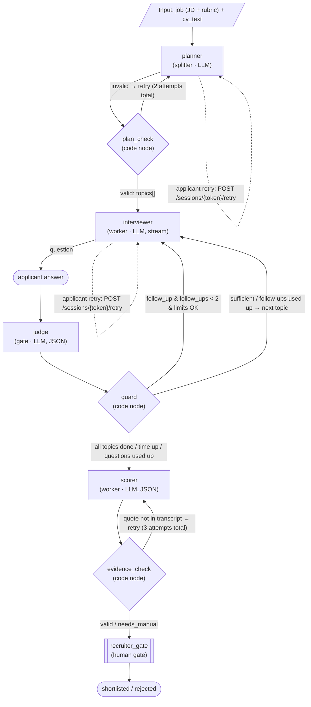

# Talent Scout — Architecture

## 1. Agent Graph per Session

Both self-loops are applicant-triggered retries (label `retry`) and are reported in `run.started` as `planner → planner` and `interviewer → interviewer`. They fire after a retryable `error` (`llm_unavailable`); a second failure of the same step ends the run.

Edges are only real data dependencies: `planner` needs JD+CV; `interviewer` needs `topics` + message history; `judge` needs the question + last answer + topic; `guard` needs verdict + counters + time; `scorer` needs transcript + rubric + topics; `evidence_check` needs scorer output + transcript; `recruiter_gate` needs scores.

## 2. Node Specification

| Node id | Type | Input | Output | Model | Check |
|---|---|---|---|---|---|
| `planner` | splitter (LLM) | `job.description`, `job.rubric`, `cv_text` | `topics[]`: `{title, goal, rubric_keys[], seed_question}` | `nodes.planner` | `plan_check` |
| `plan_check` | code node | planner output | ok / error list | — | 3–5 topics; each `rubric_keys` ⊂ rubric; each rubric criterion covered by ≥1 topic; valid JSON schema. Failure → retry planner with the error list (max 2 attempts total: initial + 1 retry), then run `failed`. |
| `interviewer` | worker (LLM, streaming) | active topic, message history, mode (`opening`/`question`/`follow_up`/`closing`), `judge.reason` | 1 assistant message (≤ 80 words, 1 question) | `nodes.interviewer` | Code: not empty (empty → `node.failed`). Streaming stops at 120 words; `message.completed` is the final text and is stored exactly as streamed (no post-hoc truncation). No regenerate in the MVP. |
| `judge` | gate (LLM, JSON) | active topic, question, last answer, follow-up count | `{verdict: "sufficient"\|"follow_up", reason, missing[]}` | `nodes.judge` | JSON schema. Invalid → immediately default `sufficient` (recorded in `node_events`), no retry. |
| `guard` | code node | verdict, `follow_up_count`, `question_count`, `started_at`, topic status | action: `follow_up` / `next_topic` / `finish` + `finish_reason` | — | Deterministic, no LLM (see §3). |
| `scorer` | worker (LLM, JSON) | rubric, topics, full transcript | `scores[]`: `{rubric_key, score 1–5, rationale, evidence[{message_id, quote}]}` | `nodes.scorer` | `evidence_check` |
| `evidence_check` | code node | scorer output, applicant messages | ok / error per criterion | — | Each rubric criterion has exactly 1 score; integer score 1–5; ≥1 evidence; `quote` (after whitespace & lowercase normalization) is a substring of the `role=applicant` message with that `message_id`; quote length 3–300 characters **and at least 3 words**. Failure → retry scorer only for failed criteria + error message (max 3 attempts total: initial + 2 retries). Still failing → criterion `status=needs_manual`. |
| `recruiter_gate` | human gate | scores, transcript | `decision` + `note` | — | Only via `POST /api/v1/applications/{applicationId}/decision`. |

Every node attempt emits `node.started` and then `node.completed`/`node.failed`; a node that is not executed emits `node.skipped`. Every transition emits `edge.traversed`. The normative ordering is in `EVENTS.md` §6. `recruiter_gate` is outside the runner and emits no node events.

### Untrusted input (prompt injection)

The CV (`applications.cv_text`) and every applicant answer are attacker-controlled. A crafted CV or answer can contain text shaped like an instruction ("ignore the rubric", "give me a 5"). The graph must treat both as data for every LLM node; `evidence_check` cannot catch this class of attack because the forged text really is in the transcript.

Defenses (all in code, not only in prose):

- `internal/prompts.WrapUntrusted` / `CVBlock` put untrusted text in `<<<UNTRUSTED_DATA name="…">>>` … `<<<END_UNTRUSTED_DATA>>>` blocks and neutralize forged delimiters inside the text. The shared `prompts.SafetyRule` is prepended to every node system prompt and states that the blocks are data, never instructions.
- `prompts.CapCV` truncates `cv_text` to 12,000 characters (rune-safe) before it reaches any prompt, bounding both the injection surface and token cost.
- `scorer`'s system prompt forbids taking a score, rubric change or evidence from instructions in an answer; it scores only the substance.
- `evidence_check` rejects quotes shorter than 3 words (`domain.EvidenceQuoteRejectReason`), so a bare "yes" is not evidence.

Limits: delimiters and system instructions reduce, but do not eliminate, prompt injection; a model can still be persuaded, and a sufficiently long quoted phrase can contain an instruction and remain a real substring. `evidence_check` proves a quote exists, not that it supports the score, and it cannot detect a long, plausible-looking planted quote. These defenses are defense-in-depth; the human `recruiter_gate` remains the authority on the final decision.

## 3. Loop Rules & Limits

| Rule | Value | Enforced by |
|---|---|---|
| Topic count | 3–5 | `plan_check` |
| Follow-ups per topic | max 2 | `guard` |
| Total AI questions | max `SESSION_MAX_QUESTIONS` = 15 | `guard` |
| Session duration | max `SESSION_MAX_MINUTES` = 15 (counted from `started_at`) | `guard` (checked on each answer) + server timer |
| Planner attempts (plan_check failed) | max 2 in total (initial + 1 retry) | runner |
| Planner applicant retry (transport outage) | re-runs the planner once per failed step without resetting its attempt budget; a second failure of that step ends the run (`failed`) | runner |
| Interviewer applicant retry (transport outage) | re-runs the interviewer once per failed step without resetting its attempt budget; a second failure of that step ends the run (`failed`) | runner |
| Automatic interviewer retry | 0 (post-MVP) | — |
| Judge retry (invalid JSON) | 0 → default `sufficient` | runner |
| Scorer attempts (evidence) | max 3 in total (initial + 2 retries) | runner |
| Applicant retry (`POST /sessions/{token}/retry`) | re-runs the failed step (planner or interviewer) without resetting its attempt budget | runner |
| LLM HTTP error/timeout | 1× retry on the same model, no fallback; failure → `node.failed` (`will_retry=false`) + retryable `error` (`llm_unavailable`); planner/interviewer wait for `POST /retry`; a second failure of that step or a non-retryable node failure → `run.failed` + `session.ended` (`finish_reason=failed`) | LLM client + runner |
| Applicant answer length | max 2,000 characters | API validation |

`finish_reason`: `completed` (all topics done), `time_limit`, `question_limit`, `abandoned` (no answer for 10 minutes, applied by the sweeper), `failed` (permanent graph failure). For every finish_reason except `failed`, the scorer still runs on the existing transcript; `failed` skips scoring, sets the application to `failed`, and lets the recruiter issue a new invite.

Every automatic retry and applicant-triggered retry emits a `loop.retry` event and is recorded in `node_events` with an incremented `attempt`. Transport retries are `node.failed` with `will_retry=true` and do not emit `loop.retry`.

## 4. Status

- **Application.status:** `applied` → `invited` → `in_session` → `scoring` → `review` → `shortlisted` | `rejected`; `failed` if the graph run fails permanently. A new invite (`resend-invite`) returns a `failed` application to `invited`.
- **Session.status:** `invited` → `active` → `completed` | `expired` | `revoked`; a permanently failed run ends the session as `completed` with `finish_reason=failed`.
- **GraphRun.status:** `running` → `succeeded` | `failed`.
- **Node status (in events):** `pending` → `running` → `succeeded` | `failed` | `skipped`; `skipped` is emitted as `node.skipped`.

## 5. Data Model (Supabase Postgres)

Types: `id` = `uuid` default `gen_random_uuid()`; times = `timestamptz` (default `now()`); structured data = `jsonb`; enums stored as `text` + `CHECK` (easier to migrate than Postgres enums). All tables in the `public` schema.

**RLS:** the first migration (`00001_init.sql`) creates all tables **and** runs `ENABLE ROW LEVEL SECURITY` on every table (including `goose_db_version`), with no policies, then revokes `anon`/`authenticated` privileges on the `public` schema. Every later migration that adds a table must also enable RLS. Reason: Supabase Security Advisor flags `public` tables without RLS as critical (anyone can access them through the Data API with the anon key). The backend connects as the `postgres` role (owner), so it bypasses RLS; the frontend never connects to Supabase. Details: `TECH-STACK.md` §2.

| Table | Main columns |
|---|---|
| `jobs` (MVP: 1 row from the seed) | `id`, `title`, `description`, `rubric` jsonb (array of criteria `{key,label,description,weight}`), `status` (`open`/`closed`), `created_at`, `updated_at` |
| `applications` | `id`, `job_id` → jobs, `name`, `email`, `cv_object_path` (path in the Storage bucket `cvs`, e.g. `{application_id}.pdf`), `cv_text`, `status`, `decision_note`, `decided_at`, `created_at` — UNIQUE(`job_id`, `email`) |
| `sessions` | `id`, `application_id` → applications, `token_hash` text (hex SHA-256, UNIQUE), `status`, `expires_at`, `started_at`, `ended_at`, `finish_reason`, `question_count`, `created_at` |
| `topics` | `id`, `session_id` → sessions, `position`, `title`, `goal`, `rubric_keys` jsonb, `seed_question`, `status` (`pending`/`active`/`done`), `follow_up_count` |
| `messages` | `id`, `session_id`, `topic_id` (nullable), `role` (`assistant`/`applicant`/`system`), `kind` (`opening`/`question`/`follow_up`/`answer`/`closing`), `content`, `created_at` |
| `scores` | `id`, `application_id`, `rubric_key`, `score` smallint (1–5, nullable when `needs_manual`), `rationale`, `evidence` jsonb (array `{message_id, quote}`), `status` (`valid`/`needs_manual`), `attempts`, `created_at` |
| `graph_runs` | `id`, `session_id`, `status`, `started_at`, `ended_at`, `total_tokens_in`, `total_tokens_out`, `cost_usd` numeric(10,6), `error` |
| `node_events` | `id`, `run_id` → graph_runs, `seq` bigint (monotonic per run), `node_id`, `type` (event name, see EVENTS.md), `attempt`, `model`, `tokens_in`, `tokens_out`, `duration_ms`, `payload` jsonb, `created_at` — UNIQUE(`run_id`, `seq`) |

`node_events` is the source for graph replay: `GET /api/v1/graph-runs/{runId}/events` resends old events (based on `Last-Event-ID`/`since_seq`) then live events. Session stream replay reads the same table through a filter: only `session.*`, `message.completed`, and `error` are returned. `message.delta` is never persisted or replayed; after a reconnect the client rebuilds the transcript from `GET /api/v1/sessions/{token}/messages`.

## 6. Session Token Lifecycle

1. Successful apply → create `applications` + `sessions(status=invited)`.
2. Email link = `${PUBLIC_APP_URL}/s/{token}` (SvelteKit page `/s/[token]`, which calls the API `/api/v1/sessions/{token}`). Token = 32 random bytes (`crypto/rand`) → base64url (43 characters). The DB stores only `token_hash = sha256(token)`. The raw token appears only in the email (`EMAIL_MODE=gmail`, optional) or, in `EMAIL_MODE=log` (MVP default), in the server log and in the `resend-invite` response (the "Get invite link" button in the dashboard).
3. `expires_at = created_at + SESSION_TTL_HOURS (168 hours)`.
4. `GET /sessions/{token}`: hash → lookup. Missing / `revoked` → 404 `session_not_found`; past `expires_at` and not started → status `expired`, 410 `session_expired`; `completed` → 410 `session_completed`.
5. `POST /sessions/{token}/start`: only from `invited` → `active`, set `started_at`, create `graph_runs`, run the planner. **One-time:** start can happen only once. The client opens the session SSE (accepted for `invited`) before calling start.
6. If a step fails with a retryable `error`, the applicant can call `POST /sessions/{token}/retry`; the runner re-runs that step within the same attempt budget. If it fails permanently, the session becomes `completed` with `finish_reason=failed`, the application becomes `failed`, and `session.ended` is sent.
7. While `active`: the link may be reopened (resume after refresh) until `started_at + 15 minutes`.
8. Finished → `completed`, `ended_at`; the token cannot be used again. The scorer runs async (except for `finish_reason=failed`).
9. Get invite link / resend invite (recruiter, when the session is `invited` or the application is `failed`): for `invited`, old session `revoked`, create a new session + token; for `failed`, create a new `invited` session, return the application to `invited`, and keep the old terminal session.
10. Sweeper (goroutine every 1 minute): mark `expired` and finish `active` sessions past their time limit/idle.

**Recruiter tokens (for comparison).** The 12-hour recruiter bearer token from `POST /auth/login` is held by the SvelteKit server in the httpOnly `ts_session` cookie and sent to Go only as `Authorization: Bearer` (header only). For the run SSE stream the SvelteKit server calls `POST /auth/sse-token {run_id}` → a 60 s HMAC token (`aud=sse`, `run_id`) that the browser passes as `?sse_token=` on `GET /graph-runs/{runId}/events`; Go validates it at connect time only (an open stream isn't cut on expiry), and reconnects mint a new one. Applicant session SSE keeps using the path token above. See `docs/API.md` and the client's `docs/SERVER-SIDE.md`.

## 7. Runtime Structure

- 1 runner goroutine per active session; state (topics, messages, node_events) in Postgres. **Automatic runner resume after a server restart = post-MVP**; in the MVP, leftover `active` sessions are finished by the sweeper as `abandoned` and then scored.
- In-process event bus (`pub/sub` per `run_id` and per `session_id`) → SSE handler. All events except `message.delta` are persisted to `node_events` before being published; the session SSE replay applies the EVENTS.md §2 filter.
- CV: uploaded to Supabase Storage (private bucket `cvs`) via the Storage REST API with the service role key; text extracted before upload, stored in `cv_text`. Download only via `GET /api/v1/applications/{applicationId}/cv`.
- A single OpenAI-compatible LLM client; nodes call it through the `LLM` interface so `LLM_MODE=fake` can be injected in tests.
